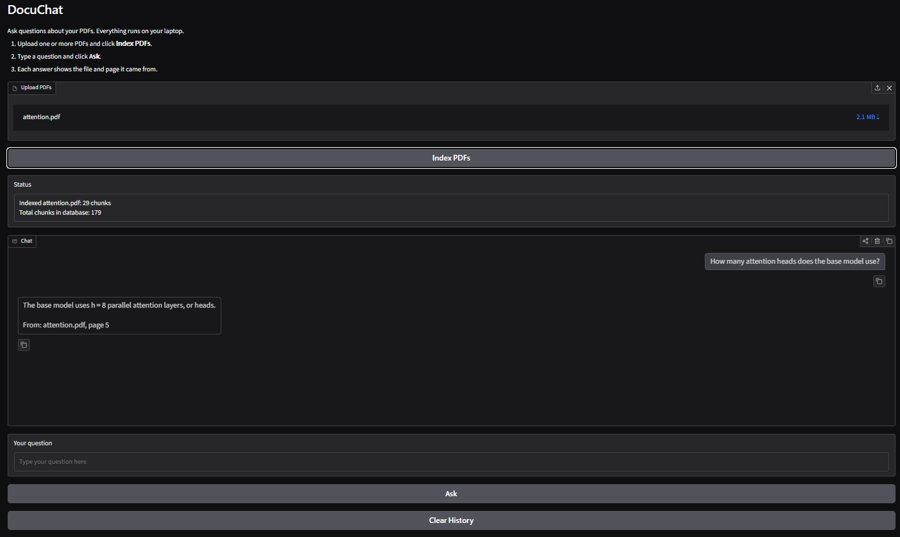
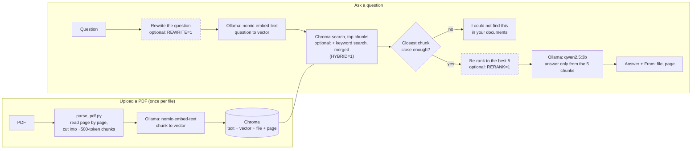

# DocuChat

Ask questions about your PDFs and get answers that tell you which file and page they came from.
It runs on your own computer: Ollama writes the answers and makes the embeddings, Chroma stores the
chunks, and Gradio gives you the web page. No API key and no cloud model.

> Built on top of the [StudyBuddy AI](https://github.com/nitu-hora/studybuddy-ai) RAG (Retrieval-Augmented Generation) pipeline.
> StudyBuddy reads lecture notes and runs on Groq. DocuChat reads any PDF you upload and runs fully local.



## How it works



Dashed boxes are optional and off by default. See "Optional upgrades" below.

| File | Job |
|---|---|
| `parse_pdf.py` | Reads a PDF page by page and cuts each page into chunks of about 500 tokens (75 tokens overlap). Every chunk keeps its file name and page. |
| `indexer.py` | Turns chunks into vectors with `nomic-embed-text` and saves them in Chroma. Re-uploading a file replaces its old chunks. |
| `retrieval.py` | Finds the chunks for a question: vector search, plus the optional keyword search, re-ranker and question rewriting. |
| `ask.py` | Takes the 5 best chunks, refuses if even the closest is far away, asks `qwen2.5:3b` to answer only from them, and works out the cited pages. |
| `app.py` | The Gradio page: upload box, chat window, example questions, Clear History. |
| `eval.py` | Runs 12 questions end to end (answer and cited page) and writes the results into this README. |
| `experiment.py` | Compares chunk sizes, embedding models and the optional upgrades on 20 questions. Tests retrieval only. |
| `langchain_version.py` | The same pipeline written with LangChain (loader, splitter, vector store, chain), for comparison. See `docs/langchain_basics.md`. |
| `questions.py` | The test questions, each with the file and page where the answer is. |

## Choices and why

| Choice | Value | Why |
|---|---|---|
| Chunk size | 500 tokens, 75 overlap | Ollama's default context window is reported as 4,096 tokens. Five chunks of about 500 tokens plus the instructions use about 2,200 tokens, so they fit. The overlap keeps a fact that sits on a cut. |
| Cut at | Sentences, inside one page | No sentence is sliced in half, and every chunk has one exact page. |
| Token counting | `tiktoken` `cl100k_base` | The limits are in tokens. It is OpenAI's tokenizer, so counts are approximate for the Qwen and Nomic models. |
| Embeddings | `nomic-embed-text` with the `search_document:` / `search_query:` prefixes | The model card asks for task prefixes. Chunks and questions must use the same model. |
| Retrieval | Top 5 chunks | The mentor spec. Top 3 is faster (see Speed). |
| Gate | Refuse if the closest chunk has distance above 0.85 | Real questions scored 0.46 to 0.6, a near-topic question 0.7, an unrelated one 1.04. The number comes from this model's own distances. |
| Gate and other embedding models | The 0.85 limit is for `nomic-embed-text` | Distances from another model are on another scale. If you change `EMBED_MODEL`, re-index and pick a new limit; the experiment table prints the two distances you need. |
| Answer model | `qwen2.5:3b`, temperature 0 | Small enough to run on a CPU-only laptop with 7.7 GB RAM. A 7B model is the next thing to try. Temperature 0 makes answers repeatable. |
| Citations | Pages of the chunks whose text the answer copied, else the closest chunk | A 3B model copies sentences almost word for word, so the copied phrase shows which chunk it used. |

## Run it

You need Python and [Ollama](https://ollama.com) installed. Tested on Windows with Python 3.13.

```powershell
git clone https://github.com/nitu-hora/docuchat.git
cd docuchat
python -m venv .venv
.venv\Scripts\activate
pip install -r requirements.txt
ollama pull qwen2.5:3b
ollama pull nomic-embed-text
python app.py
```

On macOS or Linux, activate with `source .venv/bin/activate`. Then open <http://127.0.0.1:7860>,
upload one or more PDFs, click **Index PDFs**, and ask a question.

The first run needs internet once: Ollama downloads the two models, and `tiktoken` downloads its
tokenizer file. After that, everything works offline.

`.env.example` lists the optional settings (model names, Ollama address). None are needed on a normal run.

### Optional upgrades

Off by default, so the app behaves as described above. Switch them on with environment settings
before starting the app (PowerShell shown; use `export HYBRID=1` on macOS or Linux):

```powershell
$env:HYBRID = "1"
$env:RERANK = "1"
$env:REWRITE = "1"
python app.py
```

| Setting | What it does | Cost |
|---|---|---|
| `HYBRID=1` | Also runs keyword search (BM25, a word-matching score) and merges it with vector search by Reciprocal Rank Fusion (RRF). Helps when the question contains an exact word such as "BART" (failure 5). | Small. Needs `rank-bm25`, which is in `requirements.txt`. |
| `RERANK=1` | Takes the 20 best candidates and re-scores each question and chunk pair with a cross-encoder (`cross-encoder/ms-marco-MiniLM-L-6-v2`), then keeps the best 5. | Extra install: `pip install sentence-transformers` (a large download, it brings PyTorch). The model downloads on first use. |
| `REWRITE=1` | Asks `qwen2.5:3b` to turn the question into a better search query. With chat history it also replaces words like "it" using the earlier turns. The answer prompt itself still sees only the new question. | One extra model call per question, a few seconds on a CPU. |

Whether they help is measured by `experiment.py` (next section). The plain (vector-only) mode
has been run end to end with Ollama (see Evaluation). Hybrid search, the re-ranker and query rewriting have
not been run against Ollama yet: they were tested with fake vectors and a fake re-ranker, so the
experiment table below will be their first real test.

### Docker (optional)

```bash
docker compose up --build
docker compose exec ollama ollama pull qwen2.5:3b
docker compose exec ollama ollama pull nomic-embed-text
```

Then open <http://localhost:7860>. Status: the Compose files are written but have not been run yet
by the author, and Docker adds memory use on a small laptop.

## Evaluation

`python eval.py` fills in this table (about 15 minutes on a CPU; my run took longer because one question was very slow, see the note under the table). `python eval.py --report` rebuilds the table from the saved `eval/results.csv` without re-running.

<!-- EVAL:START -->
Run on 2026-11-13 with `python eval.py`. Model `qwen2.5:3b`, embeddings `nomic-embed-text`, retrieval `dense`, top-5 chunks, laptop CPU only. The answer check is automatic: the answer must contain a keyword that the PDF contains. It is not a human grade.

| Check | Result |
|---|---|
| Answer contains the expected fact | 7/10 |
| Cited page is a correct page | 9/10 |
| Off-topic questions refused | 2/2 |
| Typical time per answered question (median) | 70 s |
| Slowest question | 1447 s |

| Question | Answer | Page | Seconds |
|---|---|---|---|
| How many identical layers does the Transformer encoder have? | pass | pass | 93.7 |
| How many attention heads does the base model use? | pass | pass | 5.2 |
| What dropout rate does the base model use? | pass | pass | 62.9 |
| What BLEU score did the Transformer get on English to German translation? | fail | pass | 66.1 |
| Which Wikipedia dump does RAG use for its document index? | fail | pass | 50.3 |
| How many documents are in the RAG Wikipedia index? | fail | fail | 58.6 |
| How are the LoRA matrices A and B initialized? | pass | pass | 1446.7 |
| How is the subspace similarity measure in LoRA related to the standard Projection Metric? | pass | pass | 78.9 |
| How was the data collected in the study of students learning languages with mobile devices? | pass | pass | 84.4 |
| In which countries does Infosys carry out CSR initiatives outside India? | pass | pass | 73.9 |
| What is the capital of France? | pass | - | 2.3 |
| How many parameters does GPT-4 have? | pass | - | 85.2 |

The median is used because one question took 1447 s, far above the rest. I did not investigate the cause. A single slow run would distort an average.
<!-- EVAL:END -->

The test PDFs are not in this repo. Download them and put them in `sample_docs/`:
[Attention Is All You Need](https://arxiv.org/abs/1706.03762) as `attention.pdf`,
[the RAG paper](https://arxiv.org/abs/2005.11401) as `rag_paper.pdf`,
[LoRA](https://arxiv.org/abs/2106.09685) as `lora.pdf`, an article on mobile-assisted language
learning (ERIC EJ1172284) as `ej1172284.pdf`, and the Board's report of an Infosys annual report as
`infosys_board_report.pdf`. Questions without their PDF are skipped.

### Speed (measured on a laptop with 7.7 GB RAM and no supported GPU)

| What | Result |
|---|---|
| Indexing `attention.pdf` (15 pages) | 29 chunks in 31 seconds |
| One answer, top 5 chunks (about 2,200 prompt tokens) | 58.7 seconds |
| One answer, top 3 chunks (about 1,200 prompt tokens) | 35.3 seconds, same correct answer on that question |
| A question the gate refuses | about 2 seconds |

Reading the prompt is the slow part on a CPU, so time grows with the number of chunks.

### Failures found while testing, and what I did

1. **The same paper uploaded under two file names was stored twice.** The duplicate check is by file name. Fix not built: fingerprint the file content.
2. **The 3B model hedged on a question it could answer** ("the context does not specify"). A softer rule plus `temperature=0` fixed it.
3. **Telling the model to reply with an exact refusal sentence made it refuse answerable questions.** I reverted the wording. One sentence in a prompt can flip a small model, so I test with real questions.
4. **Citations were wrong.** First every retrieved page was listed, then only the closest chunk's page. In a manual check of three answers, two cited the wrong page. Now it cites the chunks whose text the answer copied.
5. **Search missed a chunk.** For "retriever and generator in RAG" it found the DPR chunk but not the one naming BART. Dense (meaning-based) search can miss a plain term. Hybrid search (`HYBRID=1`) is built to fix this; the experiment table shows whether it did.
6. **The model missed a fact in a chunk it was given** (Infosys CSR in Australia and Europe). The cited page was right and the answer was incomplete. Not fixed.
7. **In the 10-question evaluation, 3 answers missed the expected fact** (BLEU score, Wikipedia dump, RAG index size), and the RAG index size question also cited a wrong page. I have not yet checked whether the chunk the model saw contained the fact. Possible causes, untested: the 3B model's reading limit (as in failure 6), and for the BLEU question the paper has two valid numbers (27.3 for the base model, 28.4 for the big model) while the check accepts only 28.4. Next step: print the retrieved chunks for these three questions and try a 7B model.

## Tests

16 automatic tests check the parts that need no model: the word splitter, the result merging, hybrid search finding an exact word, citations, the refusal gate, chunking and the question file. They need no Ollama.

```powershell
python -m unittest discover -s tests -v
```

I ran them with a fake tokenizer in my workspace, because `tiktoken` cannot download its data there; run them on your own machine with the real one.

## Experiment: chunk size, embedding model, retrieval upgrades

`python experiment.py` runs 20 questions (each with the file and page of the true answer) against
three chunk sizes (200, 500, 800 tokens) and two embedding models (`nomic-embed-text` and
`bge-m3`), then compares the optional upgrades above on the setup DocuChat uses. It builds its own index in
`chroma_exp/` and never touches `chroma_db/`. First run `ollama pull bge-m3`.
It tests retrieval only (no answer model), so it is much faster than `eval.py`.

Why `bge-m3` as the second model: its Ollama page lists an 8K-token context. `mxbai-embed-large` is
listed with a 512-token context, too short for 500-token chunks. `nomic-embed-text` uses prefixes; I
run `bge-m3` with none, which is an assumption I did not check against its model card.

<!-- EXPERIMENT:START -->
Not run yet. Run `python experiment.py` and this section fills itself in.
<!-- EXPERIMENT:END -->

## What I'd do next

- **Read the experiment, then pick defaults.** Hybrid search, the re-ranker and query rewriting are built but off. Turn on only what the table shows helps, and check the speed cost.
- **A bigger or hosted model.** A 7B model, or swapping `OLLAMA_URL` for a hosted model, for answers that are faster and read the chunks more carefully (failures 2 and 6).
- **Follow-up questions.** With `REWRITE=1` the chat history is used to rewrite the search query. The answer prompt still sees only the new question, so the model itself has no memory of the chat.
- **Fingerprint files** so the same PDF under another name is not stored twice.
- **Chunk across short pages.** Chunks never cross a page, so a page with 100 tokens gives a small chunk, and a sentence that runs over a page break is cut. Merging would need page ranges in the citation.
- **Scanned PDFs.** There is no OCR (Optical Character Recognition). A scanned PDF gives a clear error instead of an index.
- **Tables and figures** come out as messy text.
- **Prompt injection.** A PDF could contain instructions aimed at the model. The only defences are the "answer only from the context" rule and the distance gate.
- **Citations** fall back to the closest chunk when the model rewords its answer instead of copying it.

## Project layout

```
app.py            Gradio page
ask.py            gate, answer, citations
retrieval.py      vector search, hybrid, re-rank, query rewriting
langchain_version.py   the same pipeline with LangChain (optional)
indexer.py        embeddings and Chroma
parse_pdf.py      PDF reading and chunking
questions.py      the test questions
eval.py           end-to-end evaluation script
tests/            automatic tests (no Ollama needed)
experiment.py     chunk size / embedding model / retrieval experiment
eval/             results.csv, experiment.csv, modes.csv (created by the scripts)
docs/             screenshot and LangChain notes
Dockerfile, docker-compose.yml, requirements.txt, requirements-langchain.txt, .env.example
```
