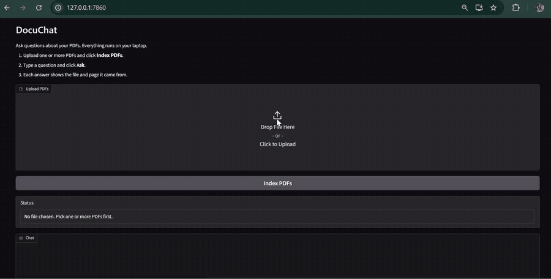
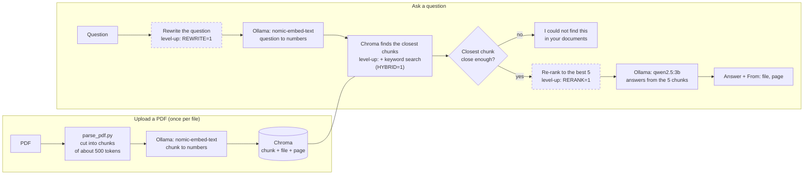

# DocuChat

Ask questions about your PDFs and get answers that show the file and page they came from.
Everything runs on your own laptop: no API key and no cloud model.

> Built on top of the [StudyBuddy AI](https://github.com/nitu-hora/studybuddy-ai) RAG (Retrieval-Augmented Generation) pipeline.
> StudyBuddy reads lecture notes and uses Groq. DocuChat reads any PDF you upload and runs fully on your laptop.




## What it does

- Upload one or more PDFs.
- Ask a question in the chat.
- The answer ends with `From: file name, page number`. Click it to open the PDF at that page.
- If the question is not about your PDFs, it says "I could not find this in your documents".

## How it works



Dashed boxes are the level-ups. They are off by default.

In words:

1. Each PDF is read page by page and cut into chunks of about 500 tokens (75 tokens overlap). A chunk never goes across two pages, so each chunk has one exact page.
2. Each chunk is turned into numbers (an embedding) by `nomic-embed-text`. Chroma saves the chunk, its numbers, the file name and the page.
3. A question is turned into numbers by the same model. Chroma returns the 5 closest chunks.
4. If even the closest chunk is too far away, the app says it cannot find the answer.
5. Otherwise `qwen2.5:3b` writes the answer using only those 5 chunks. It is told to say "don't know" if the answer is not there.
6. The app shows the file and page of the chunk the answer was copied from, as a link to the PDF.

## Setup

You need Python and [Ollama](https://ollama.com). Tested on Windows with Python 3.13.

```powershell
git clone https://github.com/nitu-hora/docuchat.git; cd docuchat
pip install -r requirements.txt
ollama pull qwen2.5:3b; ollama pull nomic-embed-text
python app.py
```

Open <http://127.0.0.1:7860>, upload PDFs, click **Index PDFs**, and ask.

- A virtual environment (`python -m venv .venv`) is a good idea but is not needed.
- The first run needs internet once (Ollama downloads the models and `tiktoken` downloads a file). After that it works offline.
- The mentor's list suggests 8B models (`qwen3:8b` or `llama3.1:8b`). This laptop has 7.7 GB RAM and no GPU, so `qwen2.5:3b` is used. A bigger model can be set with `LLM_MODEL` in `.env.example`.

### Docker (optional)

```bash
docker compose up --build
docker compose exec ollama ollama pull qwen2.5:3b
docker compose exec ollama ollama pull nomic-embed-text
```

Then open <http://localhost:7860>.

Tested once on Windows with Docker Desktop: indexing `attention.pdf` and one question (number of attention heads) worked, with the answer and the page 5 citation. On this laptop the first answer took about 7 minutes, against about 60 seconds without Docker. Docker Desktop gave the Ollama container 3.7 GiB of memory, and another container (Jenkins) was running at the same time. The reason for the extra time was not investigated. Only that one question was tried.

## What was built

Build steps from the mentor's list:

1. Load PDFs with page numbers: `parse_pdf.py` (uses `pypdf`).
2. Chunks of about 500 tokens with 75 overlap, saving file and page: `parse_pdf.py`.
3. Embeddings saved in a persistent Chroma folder: `indexer.py`.
4. Top 5 chunks and a prompt that says "answer only from the context, say you don't know otherwise": `ask.py`.
5. The answer with clickable citations (file + page): `ask.py` and `app.py`.
6. Gradio chat with a file upload box: `app.py`.

Level-ups:

- **Compare 3 chunk sizes and 2 embedding models on 20 questions:** `experiment.py` (see "Experiment" below).
- **Hybrid search (BM25 keyword + vector) and a re-ranker:** `retrieval.py`. Turn on with `HYBRID=1` and `RERANK=1`. The re-ranker is a small cross-encoder (`cross-encoder/ms-marco-MiniLM-L-6-v2`), which needs `pip install sentence-transformers`. A different one, such as `bge-reranker`, can be set with `RERANK_MODEL` (not tried).
- **Query rewriting for vague follow-up questions:** `retrieval.py`. Turn on with `REWRITE=1`. It uses the chat history to replace words like "it".

To turn them on in PowerShell, set them before `python app.py`, for example `$env:HYBRID = "1"`.

Status: the normal mode and the level-ups were all run with Ollama (see Evaluation and Experiment).

## Choices

- **Chunk size: 500 tokens, 75 overlap.** Five chunks plus the instructions come to about 2,200 tokens. Ollama's default window is reported as 4,096 tokens, so it fits. The overlap keeps a fact that sits on a cut.
- **Tokens, not characters.** Model limits are in tokens. `tiktoken` is used to count, and it is OpenAI's tokenizer, so the count is only close for the Qwen and Nomic models.
- **Embeddings: `nomic-embed-text`**, with the `search_document:` and `search_query:` prefixes that its model card asks for. Chunks and questions must use the same model.
- **Distance limit: 0.85.** Real questions scored 0.46 to 0.63 (the 20 experiment questions), a question near the topic 0.7, an unrelated one 1.04. This is how the app knows to say "I could not find this". The number is for this model. A different embedding model needs a new number.
- **Answer model: `qwen2.5:3b`, temperature 0.** Temperature 0 gives the same answer each time.
- **Pages shown:** the pages of the chunks whose words the answer copied. If none match, the closest chunk.

## Evaluation

`python eval.py` asks 12 questions and fills in this table (10 to 35 minutes on a laptop CPU, depending on the slow question).

<!-- EVAL:START -->
Run on 2026-11-13 with `python eval.py`. Model `qwen2.5:3b`, embeddings `nomic-embed-text`, top-5 chunks, laptop CPU only. The answer check is automatic: the answer must contain a word that the PDF contains. It is not a human grade.

| Check | Result |
|---|---|
| Answer contains the expected fact | 7/10 |
| Cited page is a correct page | 9/10 |
| Off-topic questions refused | 2/2 |
| Typical time per answered question (median) | 70 s |
| Slowest question | 1447 s |

| Question | Answer | Page | Seconds |
|---|---|---|---|
| How many identical layers does the Transformer encoder have? | pass | pass | 93.7 |
| How many attention heads does the base model use? | pass | pass | 5.2 |
| What dropout rate does the base model use? | pass | pass | 62.9 |
| What BLEU score did the Transformer get on English to German translation? | fail | pass | 66.1 |
| Which Wikipedia dump does RAG use for its document index? | fail | pass | 50.3 |
| How many documents are in the RAG Wikipedia index? | fail | fail | 58.6 |
| How are the LoRA matrices A and B initialized? | pass | pass | 1446.7 |
| How is the subspace similarity measure in LoRA related to the standard Projection Metric? | pass | pass | 78.9 |
| How was the data collected in the study of students learning languages with mobile devices? | pass | pass | 84.4 |
| In which countries does Infosys carry out CSR initiatives outside India? | pass | pass | 73.9 |
| What is the capital of France? | pass | - | 2.3 |
| How many parameters does GPT-4 have? | pass | - | 85.2 |

The median is used because one question took 1447 s, far above the rest. The cause was not looked into. One slow run would make an average look wrong.
<!-- EVAL:END -->

The test PDFs are not in this repo. Put them in `sample_docs/`:
[Attention Is All You Need](https://arxiv.org/abs/1706.03762) as `attention.pdf`,
[the RAG paper](https://arxiv.org/abs/2005.11401) as `rag_paper.pdf`,
[LoRA](https://arxiv.org/abs/2106.09685) as `lora.pdf`,
an article on mobile learning of English (ERIC EJ1172284) as `ej1172284.pdf`,
and the Board's report from an Infosys annual report as `infosys_board_report.pdf`.

Speed, on a laptop with 7.7 GB RAM and no GPU: indexing `attention.pdf` (15 pages) took 31 seconds for 29 chunks. One answer takes about 60 seconds with 5 chunks and about 35 seconds with 3 chunks. A refused question takes about 2 seconds. Reading the chunks is the slow part on a CPU.

### What went wrong

1. The same PDF uploaded under two names was saved twice. The duplicate check uses the file name only.
2. The 3B model gave a hedging answer to a question it could answer. A softer rule and temperature 0 fixed it.
3. Telling the model to reply with one exact sentence when unsure made it refuse questions it could answer. The wording was reverted.
4. Page numbers were wrong at first. Now the pages come from the chunks the answer copied.
5. Search missed a chunk: for "retriever and generator in RAG" it found the DPR chunk but not the one naming BART. Hybrid search is meant to fix this.
6. The model missed a fact in a chunk it was given (Infosys CSR in Australia and Europe). The page was right but the answer was incomplete.
7. In the evaluation, 3 answers missed the expected word (BLEU score, Wikipedia dump, RAG index size), and the RAG index size question also showed a wrong page. The cause is not checked yet. Possible causes, not tested: the small model reads badly (as in 6), and the BLEU question has two valid numbers in the paper (27.3 and 28.4) while the check accepts only 28.4.

## Experiment (level-up)

`python experiment.py` runs 20 questions on 3 chunk sizes (200, 500, 800 tokens) and 2 embedding models (`nomic-embed-text` and `bge-m3`). Then it compares plain search, hybrid search, the re-ranker and query rewriting. It uses its own folder `chroma_exp/`, so the real index is safe. Run `ollama pull bge-m3` first. It only tests the search step, not the answers.

`bge-m3` was picked because its Ollama page lists an 8K context. `mxbai-embed-large` lists 512, which is too short for 500-token chunks. `bge-m3` is used without prefixes. That is an assumption that is not checked.

<!-- EXPERIMENT:START -->
Run on 2026-11-14 with `python experiment.py`. 20 questions, top-5 chunks. **Hit@5** = a top-5 chunk comes from the right file and a right page. **Hit@1** = the first chunk does. **MRR** (Mean Reciprocal Rank) = average of 1/rank of the first right chunk, so 1.0 is perfect. Only retrieval is tested, not the answer text.

**Chunk size x embedding model** (plain vector search)

| Embedding model | Chunk size | Chunks | Hit@1 | Hit@5 | MRR | Worst real question distance | Closest off-topic distance | Index time (s) |
|---|---|---|---|---|---|---|---|---|
| nomic-embed-text | 200 | 398 | 13/20 | 18/20 | 0.75 | 0.57 | 0.64 | 214.6 |
| nomic-embed-text | 500 | 179 | 14/20 | 18/20 | 0.79 | 0.63 | 0.68 | 206.2 |
| nomic-embed-text | 800 | 129 | 12/20 | 18/20 | 0.7 | 0.67 | 0.61 | 181.1 |
| bge-m3 | 200 | 398 | 16/20 | 18/20 | 0.85 | 0.91 | 0.84 | 550.9 |
| bge-m3 | 500 | 179 | 18/20 | 19/20 | 0.92 | 0.86 | 0.85 | 506.5 |
| bge-m3 | 800 | 129 | 14/20 | 19/20 | 0.82 | 0.91 | 0.84 | 534.1 |

The two distance columns decide the refusal gate: it only works for a model if the worst real question is closer than the closest off-topic one. Distances from different models are not comparable with each other.

**Retrieval upgrades** (on `nomic-embed-text`, 500-token chunks)

| Retrieval | Hit@1 | Hit@5 | MRR | Seconds per question |
|---|---|---|---|---|
| dense (what DocuChat does now) | 14/20 | 18/20 | 0.79 | 0.14 |
| hybrid (vector + keyword) | 13/20 | 19/20 | 0.8 | 0.11 |
| dense + re-rank | 12/20 | 19/20 | 0.77 | 14.72 |
| hybrid + re-rank | 12/20 | 19/20 | 0.77 | 4.1 |
| hybrid + query rewriting | 14/20 | 19/20 | 0.81 | 2.85 |

<!-- EXPERIMENT:END -->

Which one wins: `bge-m3` with 500-token chunks put the right chunk first for 18 of 20 questions (MRR 0.92). `nomic-embed-text` with 500 tokens, which DocuChat uses now, did it for 14 of 20 (MRR 0.79). 500 tokens was the best size for both models.

The catch with `bge-m3`: indexing took about 2.5 times longer (507 s against 206 s). Also its distances do not separate real questions from off-topic ones (worst real question 0.86, closest off-topic 0.85), so the "I don't know" distance limit would not work for it as it is. With `nomic-embed-text` they do separate (0.63 against 0.68), but the app limit of 0.85 is looser than that, so it only blocks clearly unrelated questions.

Hybrid search, the re-ranker and query rewriting changed Hit@5 by one question (18 to 19) and Hit@1 by 0 to -2. On 20 questions that is too small to call a win. The re-ranker also made each search slower (4 to 15 s against 0.1 s). So they stay off by default.

## What I'd do next

- Switch to `bge-m3` (it was better in the experiment) and set its own distance limit, or test a tighter limit (about 0.65) for `nomic-embed-text`.
- Try a larger test set (more than 20 questions) before deciding about hybrid search, the re-ranker and rewriting.
- Try a bigger model (7B or 8B) or a hosted one, for faster and more careful answers (problems 2 and 6).
- Check the file content so the same PDF is not saved twice.
- Follow-up questions: with `REWRITE=1` the chat is used to rewrite the search, but the answer step still sees only the new question.
- Scanned PDFs: there is no OCR (Optical Character Recognition), so they give an error.
- Tables and figures come out as messy text.
- Prompt injection: a PDF could contain instructions meant for the model. Only the "answer from the context" rule and the distance limit protect against it.
- Scaling: cache repeated questions, embed in batches (already done, 16 at a time), and watch rate limits and cost if a hosted model is used.

## Files

| File | What it does |
|---|---|
| `parse_pdf.py` | Reads a PDF and cuts it into chunks. |
| `indexer.py` | Makes the embeddings and saves chunks in Chroma. |
| `retrieval.py` | Finds the chunks. Has the level-ups: keyword search, re-ranker, question rewriting. |
| `ask.py` | Checks the distance, asks the model, works out the pages to show. |
| `app.py` | The Gradio web page. |
| `eval.py` | Asks 12 questions and writes the Evaluation table. |
| `experiment.py` | The level-up experiment. |
| `questions.py` | The test questions, with the file and page of each true answer. |
| `Dockerfile`, `docker-compose.yml`, `.env.example` | Docker and settings. |
